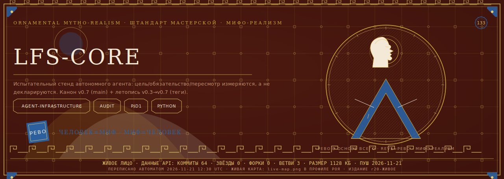
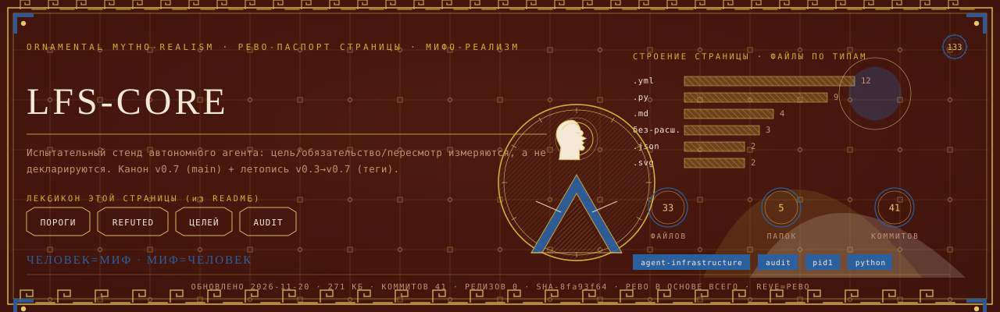

<div align="center">

<a href="https://github.com/rtynbirf/lfs-core"></a>

</div>

<!--ФОРЖ:МУЗА:НАЧАЛО-->
<div align="center">
  
  <br/>
  
</div>
<!--ФОРЖ:МУЗА:КОНЕЦ-->

<!--ФОРЖ:ПАСПОРТ:НАЧАЛО-->
<div align="center">
  
</div>

| ФАЙЛОВ | ПАПОК | КОММИТОВ | ОБНОВЛЕНО | РЕЛИЗОВ |
|---:|---:|---:|---|---:|
| 41 | 6 | 96 | 2026-11-28 | 0 |
<!--ФОРЖ:ПАСПОРТ:КОНЕЦ-->

# lfs-core

<div align="center">

<a href="https://github.com/rtynbirf/lfs-core"></a>

</div>


# lfs-core

<p align="center"></p>

<div align="center">

<a href="https://github.com/rtynbirf/lfs-core"></a>

</div>


# LFS CORE

Испытательный стенд автономного агента: цель/обязательство/пересмотр измеряются,
а не декларируются. Летопись ядер из груза Downloads.7z (интеграция в дом, 2026-11-18).

## Летопись версий (теги)

| Тег | Ядро | Факт |
|---|---|---|
| `v0.3.0` | минимальное ядро | event/experience/verify/autonomy; Follower REFUTED (0.90→0.00), Explorer NOT_REFUTED |
| `v0.4.0` | усложнённые испытания | autonomy.py расширен |
| `v0.4.1` | патч аудита | пороги зафиксированы 0.10/0.90 (AUDIT.md) |
| `v0.5.0` | Goal Genesis | GOAL / GOAL_ABANDON; пороги 0.10/0.85 |
| `v0.5.1` | патч аудита | происхождение целей проверяет harness, самоотчёт не принимается |
| `v0.6.0` | Goal Necessity | нужны ли цели; агенты A–D; пороги 0.08/0.80 |
| `v0.6.1` | большой аудит | commitment ценен; функциональная ценность целей НЕ подтверждена; decay/harsh; 15 тестов |
| `v0.7.0` | **канон (main)** | жёсткое разделение механизмов; пороги 0.10/0.90; STEPS=70; режимы A–E |

## Режимы (v0.7)

`A_Reactive` myopic · `B_Sticky` упорство без целей · `C_External` внешняя цель
(без оракула) · `D_SelfGoal` самостоятельная цель · `E_SelfRevise` цель + пересмотр/отказ
по ценности. Pre-registered и не меняются: margin=0.10, min_pass_rate=0.90, STEPS=70.

## Запуск

```bash
python3 -m unittest discover -s tests -v
python3 run_demo.py
```

## Границы

NOT_REFUTED ≠ доказано. Аудит v0.6.1: основной эффект даёт упорство; «цели ценны»
на стенде не подтверждено — открытая задача. Аудиты: AUDIT.md в v0.4.1 / v0.5.1 / v0.6.1.

<!--ФОРЖ:ПОДВАЛ-->
